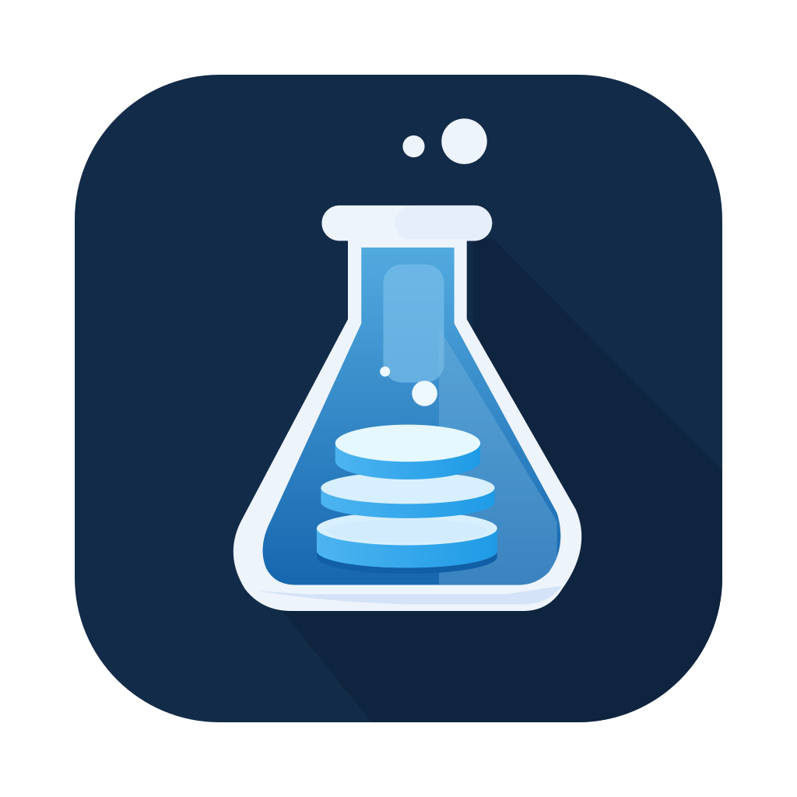

# SQLab

**Datenbanken verstehen. Daten entdecken.**

SQLab ist eine Desktop-App für den Unterricht mit relationalen Datenbanken und SQL. Lernende erkunden Daten, erkennen Zusammenhänge und lösen Aufgaben direkt in der App. Lehrkräfte können eigene Lernpakete mit Datenbanken, Aufgaben und Material vorbereiten und weitergeben.

**[Downloads und Änderungshinweise →](https://github.com/cartz/SQLab-releases/releases)**

Dieses Repository stellt die Installationsdateien und automatischen Updates bereit. Der Projektquellcode wird separat verwaltet.

## Zwei Ausgaben

| Ausgabe          | Für wen?                 | Funktionen                                                                                                                               |
| ---------------- | ------------------------ | ---------------------------------------------------------------------------------------------------------------------------------------- |
| **SQLab**        | Schülerinnen und Schüler | Daten erkunden, SQL schreiben, Lernpakete bearbeiten und Aufgaben lösen.                                                                 |
| **SQLab Lehrer** | Lehrkräfte               | Zusätzlich eigene Datenbanken und Lernpakete erstellen, Aufgaben und Material bearbeiten sowie Musterlösungen vor der Weitergabe prüfen. |

## Was bietet SQLab?

- **Daten erkunden:** Tabellen durchsuchen, filtern und sortieren sowie Datensätze bearbeiten.
- **Zusammenhänge verstehen:** Beziehungen zwischen Tabellen und die Struktur einer Datenbank untersuchen.
- **SQL ausprobieren:** Eigene Abfragen im SQL-Labor ausführen und die Ergebnisse direkt sehen.
- **Mit Aufgaben lernen:** Ansichts- und SQL-Aufgaben lösen, Hinweise nutzen und Ergebnisse automatisch prüfen lassen.
- **Material griffbereit:** Erklärungen, Bilder und SQL-Beispiele neben der Arbeitsfläche oder in einer Großansicht lesen.
- **Später weiterarbeiten:** Den eigenen Aufgabenstand automatisch und manuell speichern und wieder öffnen.
- **Offline arbeiten:** Lernpakete ohne Benutzerkonto und ohne Datenbankserver nutzen. Für Downloads und die optionale Update-Prüfung ist eine Internetverbindung nötig.

Mitgeliefert werden die Lernpakete **Bibliothek**, **Schule**, **Tierheim** und **SchulGram – Datenbanken und Datenschutz**. Eigene Lernpakete bündeln Datenbank, Aufgaben und Material in einer `.sqlab`-Datei; persönliche Aufgabenstände werden als `.sqlab-stand` gespeichert.

## Installation auf dem Mac

1. Unter **[Releases](https://github.com/cartz/SQLab-releases/releases)** die DMG der gewünschten Ausgabe herunterladen.
2. Die DMG öffnen und die App in den Ordner **Programme** ziehen.
3. SQLab bzw. SQLab Lehrer aus dem Programme-Ordner starten. Beim allerersten Start den unten beschriebenen Schritt einmal bestätigen.

Die aktuellen Mac-Pakete sind für **Apple Silicon** vorgesehen; erkennbar an `aarch64` im Dateinamen. Falls weitere Architekturen angeboten werden, stehen die entsprechenden Dateien im jeweiligen Release. Beide Ausgaben lassen sich nebeneinander installieren.

### Beim ersten Start

SQLab ist noch nicht von Apple notarisiert. macOS meldet deshalb beim ersten Start, dass es die App nicht überprüfen konnte, und öffnet sie nicht. Ab Version **0.5.10** lässt sich das einmalig in den Systemeinstellungen freigeben:

1. In der Meldung auf **Fertig** klicken (nicht „In den Papierkorb legen“).
2. **Systemeinstellungen → Datenschutz & Sicherheit** öffnen und nach unten zum Abschnitt **Sicherheit** scrollen.
3. Neben dem Hinweis zu SQLab auf **Dennoch öffnen** klicken und mit Passwort oder Touch ID bestätigen.
4. In der folgenden Meldung **Öffnen** wählen.

Danach startet die App normal. Updates über „Nach Updates suchen…“ brauchen diesen Schritt nicht erneut. Diesen Schritt nur für die hier verlinkten, vertrauenswürdigen Downloads durchführen.

### Alternative im Terminal

Für Version **0.5.9 und älter** sowie für die Schul-IT auf verwalteten Geräten: Nach dem Kopieren in **Programme** das Quarantäne-Attribut im **Terminal** entfernen.

**SQLab:**

```sh
xattr -d com.apple.quarantine "/Applications/SQLab.app"
```

**SQLab Lehrer:**

```sh
xattr -d com.apple.quarantine "/Applications/SQLab Lehrer.app"
```

Die Anführungszeichen gehören zum Befehl und sind insbesondere beim App-Namen mit Leerzeichen notwendig. Meldet Terminal, dass das Attribut nicht vorhanden ist, kann die App bereits direkt gestartet werden. Über eine MDM-Lösung verteilte Apps sind in der Regel nicht betroffen.

## Updates

Ab Version **0.5.7** ist eine Update-Prüfung in der App vorbereitet. Sobald ein neuer Release im Updatekanal veröffentlicht ist, kann die App ihn über **„Nach Updates suchen…“** anbieten. Die automatische Prüfung beim Start lässt sich im Update-Dialog abschalten.

Vor einer Installation wird der Arbeitsstand gespeichert. Offene SQL-Änderungen und ungespeicherte Formulareingaben müssen zuerst abgeschlossen werden. Auf zentral verwalteten Geräten kann die Schul-IT die Updates verteilen.

Für eine manuelle Mac-Installation die **DMG** verwenden. Die zusätzlichen Dateien `.app.tar.gz`, `.sig` und `*-latest.json` sind für den eingebauten Updater bestimmt. `SHA256SUMS.txt` enthält die Prüfsummen der Release-Dateien.

## Windows

Eine Windows-Ausgabe ist geplant. Aktuell werden ausschließlich Mac-Pakete bereitgestellt; die verfügbaren Plattformen und Änderungen sind jeweils im Release beschrieben.
